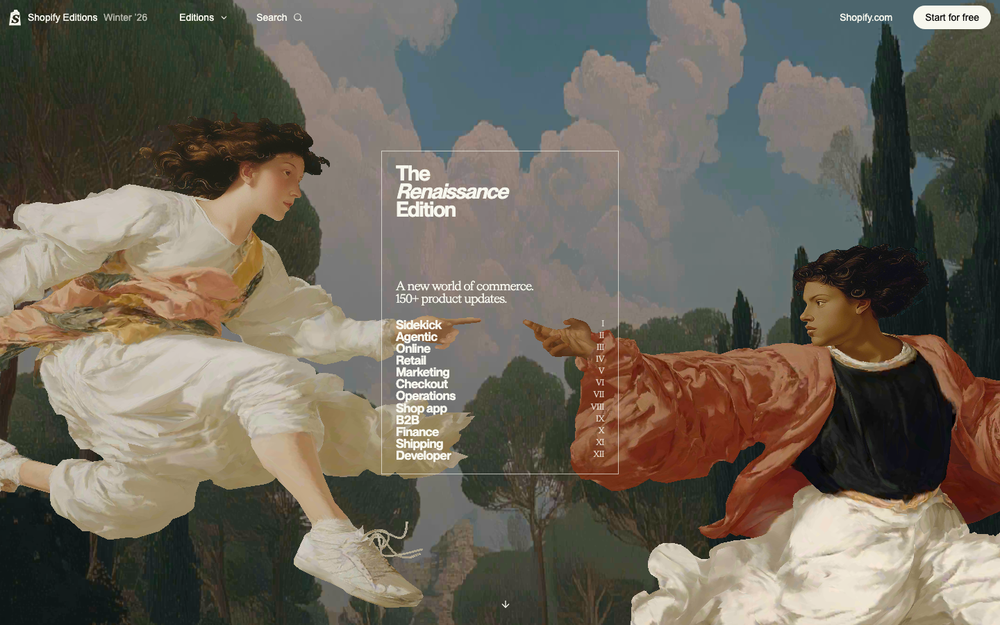
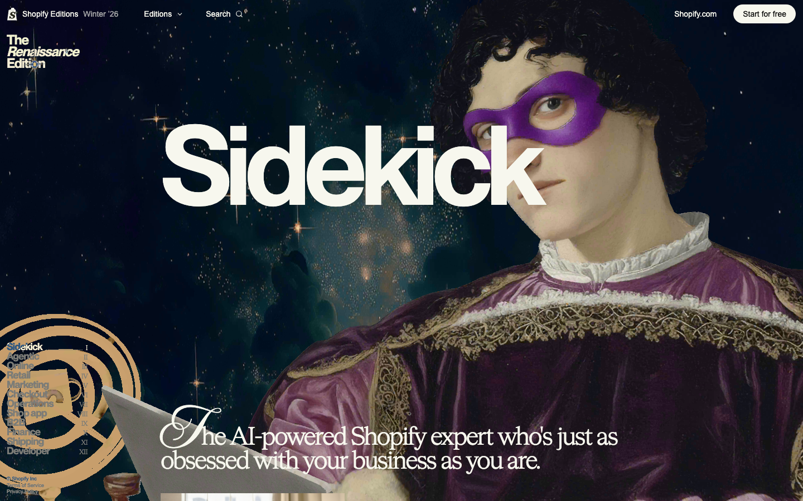
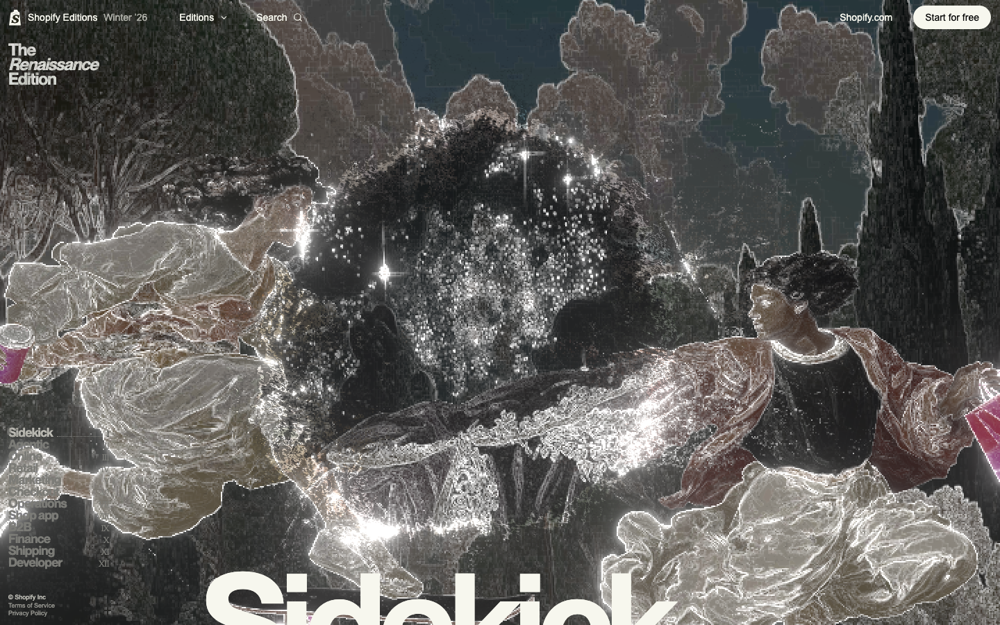
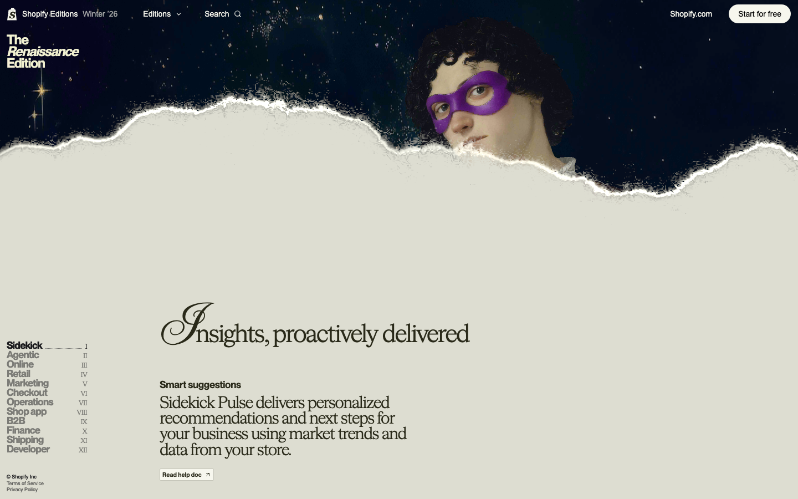
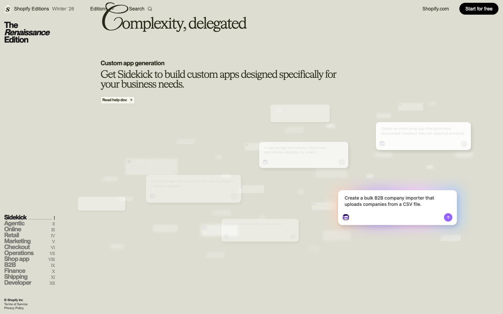

# Shopify Editions — Interactive Replica

**An AI-assisted frontend reconstruction study of Shopify Winter ’26: Renaissance art, WebGL scenes, and scroll-driven storytelling.**

以 Shopify Winter 2026 英文官网为参考的交互复刻项目。通过原站观察、资源核验、视觉拆解、代码实现与截图回归，把一段复杂的品牌叙事页面还原为可运行的前端样段。



## Background & scope

The reference is [Shopify Editions Winter 2026](https://www.shopify.com/editions/winter2026), “The Renaissance Edition.” This study explores how editorial typography, layered painted scenes, pointer interaction, and shader transitions can share one coherent scroll timeline.

The current sample covers **Hero → Sidekick → Insights / Pulse → Complexity, delegated**. It is a work in progress, not a complete or pixel-perfect reconstruction of the entire Editions website.

## What this project demonstrates

- **Scene integration:** original GLB scenes and KTX2 textures rendered through Three.js / React Three Fiber, with pointer-responsive camera movement.
- **Scroll choreography:** a shared Lenis progress model coordinates DOM content, Theatre.js camera timelines, and shader uniforms.
- **Visual transitions:** irregular scene reveals, luminous contours, and a textured paper boundary using adapted GLSL and procedural noise.
- **Interface motion:** floating app cards with entrance animation, proximity emphasis, and pointer displacement; Rive integration for Pulse.
- **Verification:** recorded asset manifests, visual parameters, motion mappings, desktop/mobile screenshots, fallback paths, and a documented difference log.

The implementation was developed iteratively with AI coding assistance. The work here is the reconstruction workflow, frontend integration, animation coordination, and validation—not authorship of Shopify’s artwork, models, fonts, or original animation assets.

## Selected implementation screenshots

These images show the local replica, not screenshots passed off from the reference site. The transition and card images were captured during the September iteration; the Hero and Sidekick images were refreshed for this repository release.

| Sidekick scene | Irregular transition |
| --- | --- |
|  |  |

| Paper transition | Floating app cards |
| --- | --- |
|  |  |

## Stack

| Layer | Technology |
| --- | --- |
| UI & layout | React 19, TypeScript, Tailwind CSS 4 |
| 3D rendering | Three.js, React Three Fiber, WebGL / GLSL |
| Motion | Lenis, Theatre.js, Rive |
| Tooling | Vinext / Vite, Cloudflare Workers adapter, Vitest |
| Visual verification | Computer Use observation, Playwright screenshots and browser checks |

## Run locally

Requires **Node.js 22.13+** and npm.

```bash
npm ci
npm run dev -- --port 3000
```

Open **http://localhost:3000/**. Scroll from the top and move the pointer to explore the scenes. The repository does not currently advertise a public hosted demo.

```bash
# Validate and build
npx tsc --noEmit
npx vitest run --config vitest.config.ts
npm run build

# Preview the Worker build locally
npm run start -- --port 3001
```

Diagnostic URLs: `?fallback` tests the image fallback; `?qa` shows diagnostics; `?frame=1.05` fixes a scroll state for screenshot comparison. Frozen-frame mode is for testing, not the normal interactive experience.

## Structure & process

```text
app/                    Page composition, responsive layout and typography
components/replica/      WebGL stage, Pulse and floating app cards
lib/                    Shared scroll mapping, shaders and noise
public/assets/          Reference scene and media assets
public/decoders/        GLB / compressed-texture decoders
docs/                   Asset evidence, motion mapping and visual differences
```

For each visual detail: observe the reference with Computer Use → record states and assets → implement → verify with Playwright and real scrolling. A successful build alone does not establish visual fidelity.

- [Asset inventory](docs/assets-manifest.json), [Rive dependencies](docs/rive-assets-manifest.json), [app-card assets](docs/apps-assets-manifest.json)
- [Visual parameters](docs/visual-parameters.md) and [motion mapping](docs/motion-map.md)
- [Known differences](docs/differences.md) and [verification notes](docs/verification.md)
- [Build & deployment](docs/deployment.md)

## Status & limitations

The sample runs locally and builds successfully. Some materials, camera framing, transition timing, and mobile behaviors still differ from the reference. Later chapters are not implemented. The mobile card presentation is simplified, and the app cards do not open a complete product workflow. Some Rive runtime resources require network access. Large WebGL dependencies still produce a bundle-size warning; this is not presented as a production performance benchmark.

## Attribution

This is an **unofficial educational / portfolio study**, with no affiliation with or endorsement by Shopify. Shopify’s name, branding, artwork, models, fonts, media, and animation data remain the property of their respective owners. Scene assets and portions of the shader/noise logic originate from the publicly served reference implementation and were integrated or adapted here; see the manifests for source URLs. Public availability is not a grant of reuse rights. No blanket open-source license is asserted over these third-party materials.
